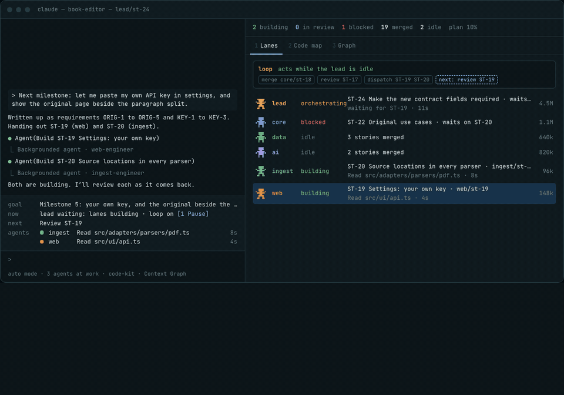

# code-kit & Context Graph

The website for two Claude Code plugins: [code-kit](https://github.com/warrendeanlangeveldt/code-kit) and [Context Graph](https://github.com/warrendeanlangeveldt/context-graph). Live at **https://warrendeanlangeveldt.github.io**.

Plain HTML, CSS and one script, no build step. `assets/harness.js` is the live replay on the home page. `_capture/` holds the bare pages the GIFs and the social card are recorded from.
